# Hướng dẫn QA: menu "Năng lực Nhân sự" và "Hồ sơ Đào tạo & Tuân thủ"

**Viết cho:** QA, người cần hiểu từng màn hình dùng để làm gì, ai bấm được nút nào, bấm lúc nào, và nút hiện ra khi nào.
**Nguồn:** mã nguồn (giao diện và máy chủ), SOP.0003.02, bảng đối chiếu `eqms-backend/docs/validation/TRAINING_SOP0003_TRACEABILITY_AND_QA_SIGNOFF.md`, Decision Log. Ảnh chụp trên **DEV**, tài khoản `admin`, giao diện tiếng Việt.
**Tài liệu này không phải phê duyệt GMP.** Điều kiện hiện nút trong tài liệu được **đọc từ mã nguồn**, chưa chạy thử từng nút bằng nhiều tài khoản khác nhau (xem mục 11).

---

## 1. Hai menu này nằm ở đâu trong quy trình

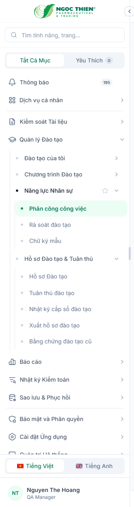

| Menu | Việc chính | SOP.0003 |
|---|---|---|
| **Năng lực Nhân sự** | Người nào giữ vị trí nào, đã đủ đào tạo chưa, chữ ký mẫu, rà soát khi chuyển vị trí | 5.3.8, 5.3.9, 5.3.11 |
| **Hồ sơ Đào tạo & Tuân thủ** | Kết quả sau đào tạo: hồ sơ cá nhân, ai còn thiếu, sổ cấp mã, xuất hồ sơ | 5.3.10, 5.1.4, 5.1 |

Menu **Chương trình Đào tạo** (Requirements, Activities, Matrix, Assessments, Document Impact Assessment) là phần lập kế hoạch và tổ chức. Hai menu này là phần "con người và hồ sơ".

```
Training Matrix ──► Phân công công việc  (so người với ma trận trước khi giao việc)
               ├──► Tuân thủ đào tạo    (đo ai thiếu so với ma trận)
               └──► Rà soát đào tạo     (so khi chuyển bộ phận)

Yêu cầu đào tạo ► Hoạt động đào tạo ► Sổ cấp mã đào tạo
Hoạt động đào tạo hoàn tất ► Hồ sơ đào tạo ► Tuân thủ đào tạo, Xuất hồ sơ
Danh sách khoảng trống, Rà soát đào tạo ► tạo hoặc thêm vào Hoạt động đào tạo
```

Hồ sơ đào tạo do hoạt động đào tạo hoàn tất ghi ra. Ba màn Hồ sơ, Tuân thủ và Xuất hồ sơ **không nhập tay**.

## 2. Cách đọc các bảng "ai bấm, khi nào, hiện khi nào"

- **Quyền** ghi bằng mã (ví dụ `training.job_assignment.manage`) kèm phạm vi: người có quyền **trong bộ phận của nhân viên** (hoặc có quyền xem mọi bộ phận).
- **Hiện khi nào** là điều kiện để nút xuất hiện. Nút không hiện nghĩa là điều kiện chưa đủ, không phải lỗi.
- **Nút mờ (disabled)** là nút hiện nhưng chưa bấm được, kèm lý do.
- Nút dẫn tới hộp thoại **chữ ký điện tử** sẽ hỏi mật khẩu; chữ ký có "ý nghĩa" ghi vào Audit Trail.
- Giao diện chỉ **gợi ý**. Máy chủ vẫn kiểm tra lại quyền và trạng thái khi bấm, nên người không có quyền sẽ bị từ chối dù cố gọi trực tiếp.
- Bộ máy phân quyền (Hybrid engine, chính sách theo hành động) có thể **thu hẹp thêm** điều kiện dưới đây. Nếu đủ điều kiện mà nút không hiện, kiểm tra chính sách của hành động đó.

---

## 3. Phân công công việc (Job Assignments), SOP 5.3.8 (APD.0024)

**Dùng để làm gì:** trưởng đơn vị giao vị trí công việc cho nhân viên: mô tả vị trí, quyền hạn, trách nhiệm. Cả hai bên ký. Chỉ giao khi nhân viên đã đủ đào tạo theo ma trận của vị trí đó, hoặc có ngoại lệ được duyệt.

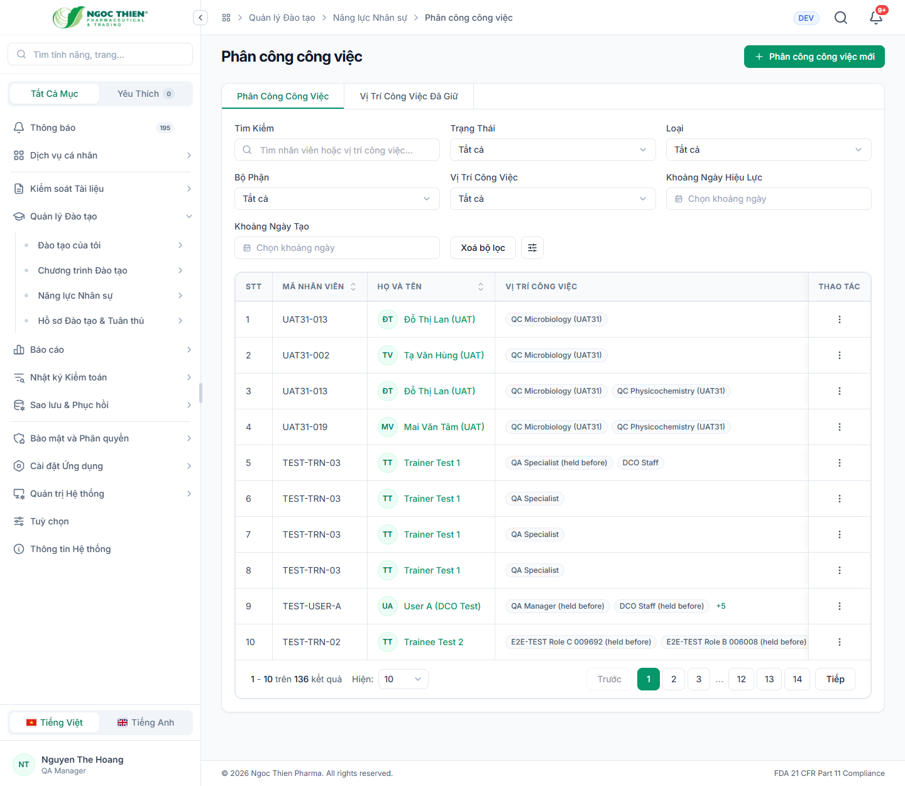

**Tạo mới:** nút **Phân công mới** (cần `training.job_assignment.manage`) mở trang tạo. Chọn nhân viên, vị trí (có thể nhiều vị trí), nhập nhiệm vụ, tích thêm đào tạo bắt buộc nếu cần.

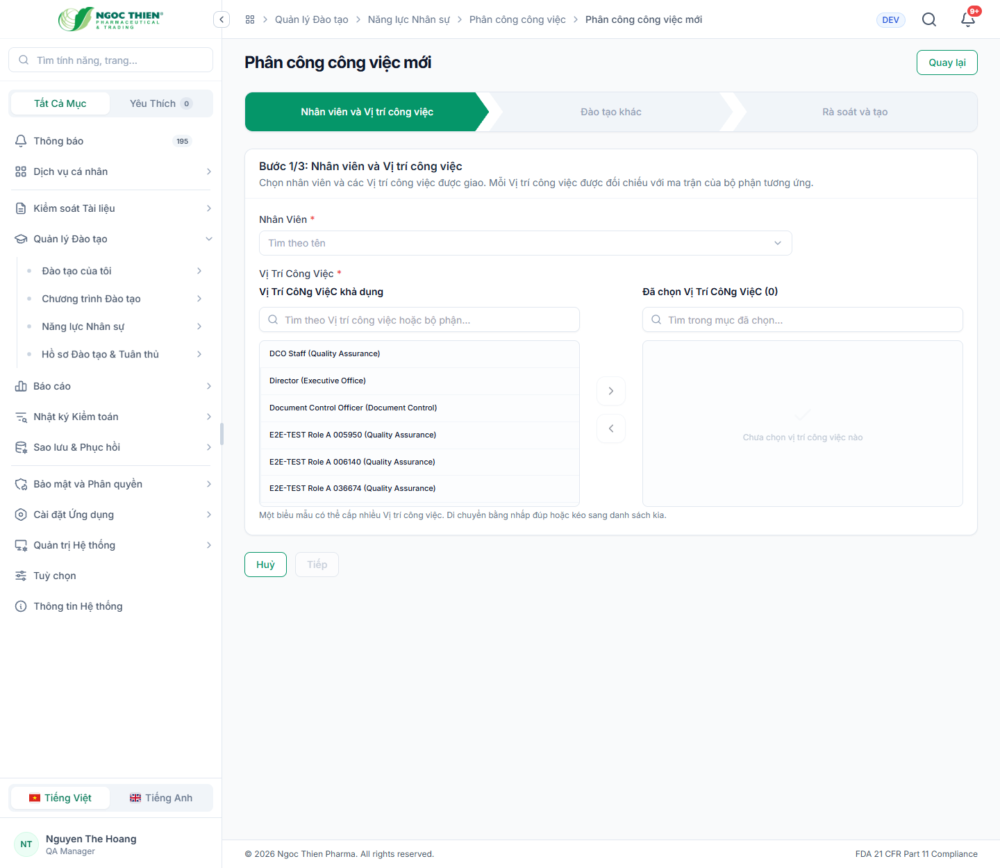

### Trạng thái

`Bản nháp` → `Chờ nhân viên chấp nhận` → `Hiệu lực` → `Đã lỗi thời` (hoặc `Huỷ`).

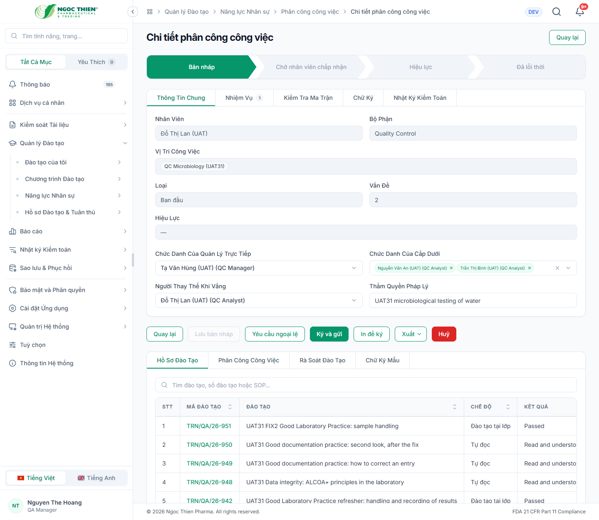

### Các nút ở cuối trang chi tiết (đây là chỗ nhiều nút nhất)

Ký hiệu: **QL** = người có `training.job_assignment.manage` trong bộ phận của nhân viên. **NV** = chính nhân viên được giao.

| Nút | Làm gì | Ai bấm | Hiện khi nào | Bấm lúc nào |
|---|---|---|---|---|
| **Quay lại** | Về danh sách (hỏi nếu có thay đổi chưa lưu) | Mọi người xem được | Luôn hiện | Bất cứ lúc nào |
| **Lưu bản nháp** | Lưu nội dung đã sửa | QL | Trạng thái **Bản nháp**. **Mờ** cho tới khi bạn sửa gì đó | Sau khi sửa, trước khi ký |
| **Yêu cầu ngoại lệ** | Xin giao việc dù nhân viên **chưa đủ đào tạo** theo ma trận (hoặc bộ phận chưa có ma trận hiệu lực). Nhập lý do và chọn người duyệt | QL | **Bản nháp**, và ngoại lệ **chưa được duyệt** | Khi Ma trận chưa đủ mà phải giao ngay |
| **Hoàn tất phê duyệt** | Người duyệt ký xác nhận ngoại lệ | **Chỉ người được chọn** làm người duyệt, có quyền `training.job_assignment.exception.approve`, **không phải người tạo phân công**, không phải nhân viên | **Bản nháp**, và đang có một yêu cầu ngoại lệ gán cho bạn | Sau khi có yêu cầu ngoại lệ |
| **Ký và gửi** | Người giao việc ký, chuyển sang **Chờ nhân viên chấp nhận**, nhân viên nhận thông báo | QL, **không phải chính nhân viên đó** | **Bản nháp**. **Mờ** khi còn thay đổi chưa lưu | Khi nội dung xong. Máy chủ chặn nếu chưa có nhiệm vụ nào, hoặc ma trận chưa đủ mà chưa có ngoại lệ được duyệt |
| **Chấp nhận** | Nhân viên ký nhận. Phân công thành **Hiệu lực** và vị trí của người được ghi cho ma trận | **Chỉ NV** | **Chờ nhân viên chấp nhận** | Sau khi đọc phân công |
| **In để ký** | In bản giấy APD.0024 để hai bên ký tay | QL | **Bản nháp** hoặc **Chờ nhân viên chấp nhận** (cùng điều kiện với nút Huỷ) | Khi ký trên giấy. Có hỏi lý do in |
| **Xuất** (Word/PDF) | Tải bản APD.0024 đã điền | Người xem được | Mọi trạng thái trừ **Huỷ** | Khi cần bản điện tử hoặc xem trước |
| **Huỷ** | Huỷ phân công, **bắt buộc nhập lý do**, bản ghi vẫn được giữ | QL | **Bản nháp** hoặc **Chờ nhân viên chấp nhận** | Khi giao sai. Không huỷ được khi đã **Hiệu lực** |

**Vì sao thấy nhiều nút:** trang gom cả việc soạn (Lưu), ngoại lệ (2 nút), ký (Ký và gửi, Chấp nhận), in/xuất (2 nút) và huỷ. Mỗi người chỉ thấy **một vài nút** theo vai và trạng thái. Ví dụ người nhận việc ở trạng thái "Chờ chấp nhận" chỉ thấy **Chấp nhận**, **Xuất**, **Quay lại**.

**Nhóm nút theo việc:** *Soạn* (Lưu bản nháp) → *Ngoại lệ nếu thiếu đào tạo* (Yêu cầu ngoại lệ, Hoàn tất phê duyệt) → *Ký* (Ký và gửi, Chấp nhận) → *In/Xuất* → *Huỷ*.

### Các tab của trang chi tiết

- **Thông tin chung**, **Nhiệm vụ**: nội dung phân công (mô tả, quyền hạn, trách nhiệm).
- **Kiểm tra ma trận**: so nhân viên với ma trận hiệu lực của bộ phận. Mỗi dòng "Đã đào tạo" hoặc "Chưa đào tạo". Đây là căn cứ cho quy tắc "đủ đào tạo mới giao".
- **Chữ ký**: ai ký, khi nào (Giao bởi, Chấp nhận bởi, Duyệt ngoại lệ bởi).
- **Nhật ký kiểm toán**.

---

## 4. Rà soát đào tạo (Training Reviews), SOP 5.3.11 và nhân viên mới

**Dùng để làm gì:** danh sách việc phải làm khi: **nhân viên mới**, **quay lại sau nghỉ dài ngày** (trên 6 tháng cần đào tạo lại), **chuyển bộ phận**, **chuyển địa điểm**. Mỗi review có checklist theo SOP và so với ma trận.

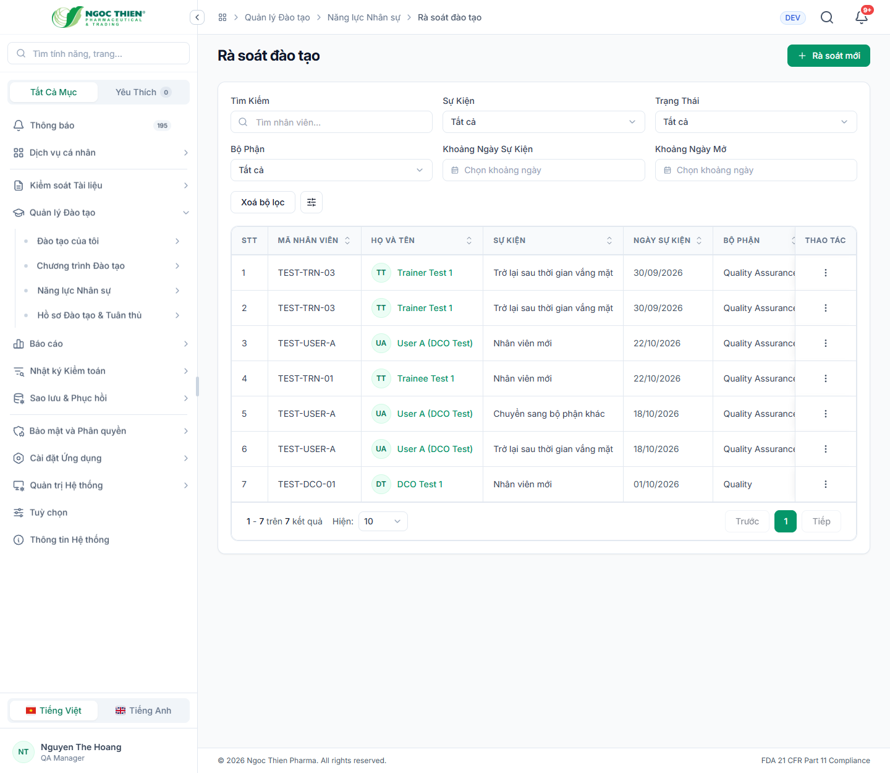

Danh sách có mục "Nhân viên mới chưa có review" nhắc việc. **Ngày bắt đầu lấy từ hồ sơ người dùng và chỉ là nhắc, không phải quy tắc**: bạn tự mở review khi thấy cần.

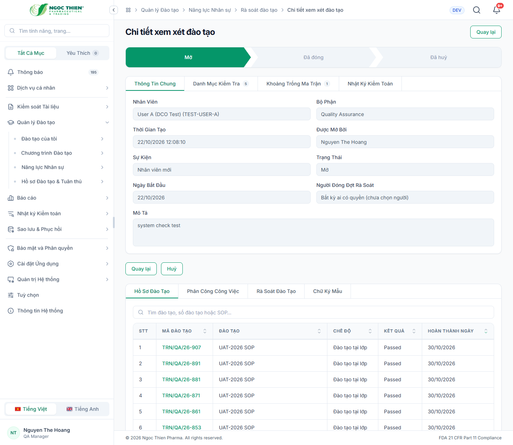

Tab: **Thông tin chung**, **Danh mục kiểm tra** (checklist theo SOP), **Khoảng trống ma trận** (đào tạo ma trận yêu cầu mà người chưa có), **Nhật ký kiểm toán**.

### Nút

| Nút | Làm gì | Ai bấm | Hiện khi nào |
|---|---|---|---|
| **Quay lại** | Về danh sách | Mọi người xem được | Luôn hiện |
| **Cập nhật** (trên từng dòng checklist) | Đổi trạng thái dòng: Đang chờ, Xong, **Không cần** (bắt buộc ghi lý do) | QL | Review **đang mở** |
| **Tạo đào tạo** (trên dòng checklist) | Tạo hoạt động đào tạo cho dòng đó, nhân viên được đưa vào danh sách | QL | Review đang mở, dòng thuộc loại có thể gắn đào tạo, **chưa gắn đào tạo**, và đang **Đang chờ** |
| **Xem bài kiểm tra scan** | Xem scan bài kiểm tra của đào tạo đã gắn | Người xem được | Dòng **đã gắn** một hoạt động đào tạo |
| **Đóng review** | Người đóng kiểm tra rồi **ký**, review thành **Đã đóng** | QL, **không phải chính nhân viên**. Nếu đã chọn người đóng thì **chỉ người đó** | Review đang mở và **mọi dòng đã xử lý** (không còn dòng Đang chờ) |
| **Đổi người đóng** | Chọn người khác đóng review (khi người đó vắng, đã nghỉ, hết quyền). Lý do và hai người được ghi lại | Người có quyền `training.approval.reassign` | Review đang mở và **đã chọn người đóng** |
| **Huỷ** | Huỷ review, **bắt buộc ghi lý do**, bản ghi vẫn được giữ | QL | Review đang mở |

Ảnh trên có hai nút **Quay lại** và **Huỷ** vì tài khoản này thuộc nhóm QL, chưa có dòng nào xong (chưa thể đóng) và chưa chọn người đóng (chưa thể đổi người đóng).

---

## 5. Chữ ký mẫu (Specimen Signatures), SOP 5.3.9 (FRM.0007)

**Dùng để làm gì:** lưu **bản scan** tờ chữ ký mẫu đã ký tay của nhân viên, để người đối chiếu có chỗ tra nhanh. **Bản gốc là tờ giấy ký tay.** Hệ thống **không tạo FRM.0007** (Decision Log D-FRM-2).

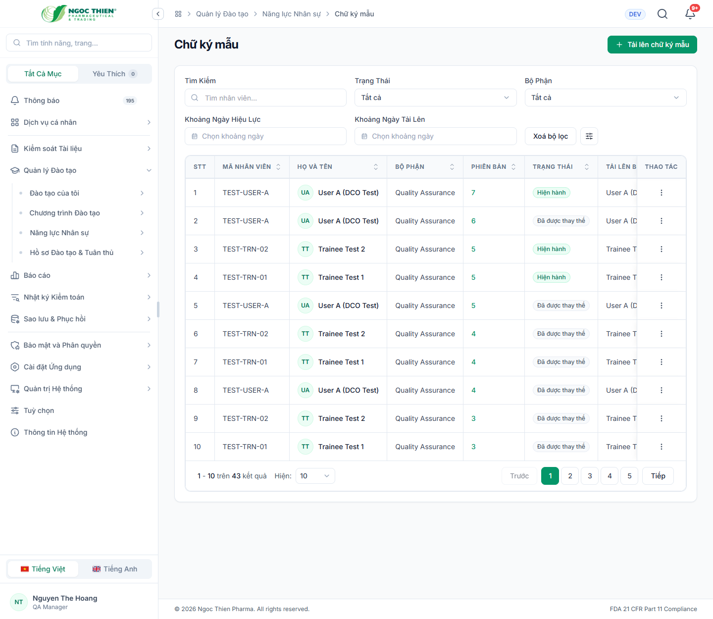

**Quy tắc hiện hành (quyết định của chủ dự án 2026-10-28, phương án A):** bản scan tải lên **trở thành bản hiện hành ngay**, không còn bước trưởng đơn vị xác nhận bằng chữ ký điện tử. Bản trước chuyển sang **Đã thay thế (Superseded)** và vẫn được giữ.

> **Lưu ý cho QA:** SOP 5.3.9 nêu "thay đổi phải được phê duyệt trước khi áp dụng chữ ký mới" và "trưởng đơn vị xác nhận chữ ký nhân sự của mình". Hệ thống hiện **không có bước phê duyệt điện tử** cho việc này (bước xác nhận cũ đã bỏ, mã quyền `training.signature.confirm` còn trong cơ sở dữ liệu để giữ lịch sử, không xác nhận gì nữa). QA cần quyết định bước phê duyệt đó là việc **ngoài hệ thống** (trên giấy) hay cần làm lại trong hệ thống. Chưa có kết luận trong Decision Log.

Trạng thái: **Hiện hành** (APPROVED), **Đã thay thế** (OBSOLETED), **Chưa xác nhận (quy trình cũ)** (PENDING_CONFIRMATION, chỉ còn ở dữ liệu cũ).

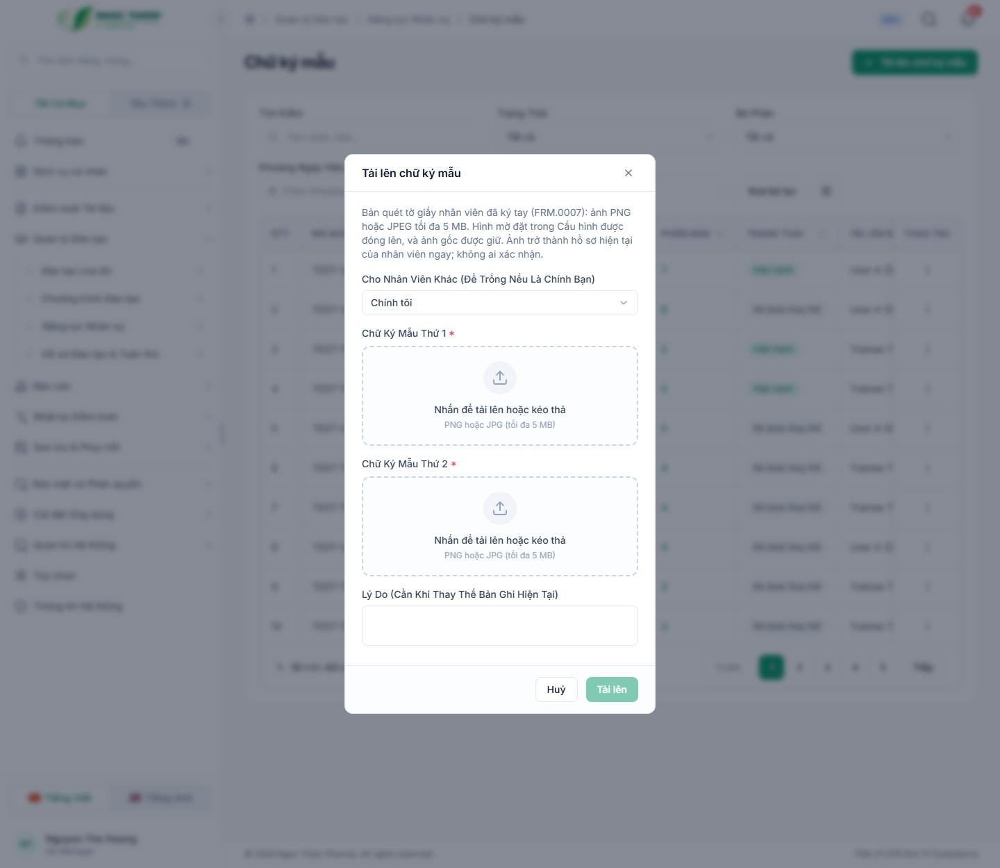

| Nút | Làm gì | Ai bấm | Hiện khi nào |
|---|---|---|---|
| **Tải chữ ký mẫu** | Tải 2 ảnh (chữ ký thứ 1 và thứ 2), chọn nhân viên (để trống là chính mình), ghi **lý do nếu thay bản đang dùng** | **Chính nhân viên** (`training.self.view`) cho bản của mình. Cho **người khác**: cần `training.signature.manage` và đúng bộ phận | Luôn hiện. Ô "cho nhân viên khác" chỉ hiện khi có `training.signature.manage` |
| **Chi tiết** (menu dòng) | Xem thông tin bản ghi | Người xem được | Mọi dòng |
| **Xem ảnh** (menu dòng) | Mở ảnh chữ ký, **mỗi lần mở được ghi vào Audit Trail** | Chính nhân viên, hoặc người có `training.signature.view/manage/confirm` trong phạm vi | Mọi dòng, với đúng người |

Chỉ nhận **PNG hoặc JPEG**. Ảnh hiển thị có thể bị đóng dấu mờ theo cấu hình (Image Watermark); người đối chiếu nét bút mở được ảnh gốc.

---

## 6. Hồ sơ đào tạo (Training Records), SOP 5.3.10 (APD.0014)

**Dùng để làm gì:** hồ sơ đào tạo cá nhân do QA quản lý. **Hệ thống ghi khi hoàn tất đào tạo, không sửa, không xoá.** Hồ sơ cũ luôn được giữ cùng hồ sơ mới.

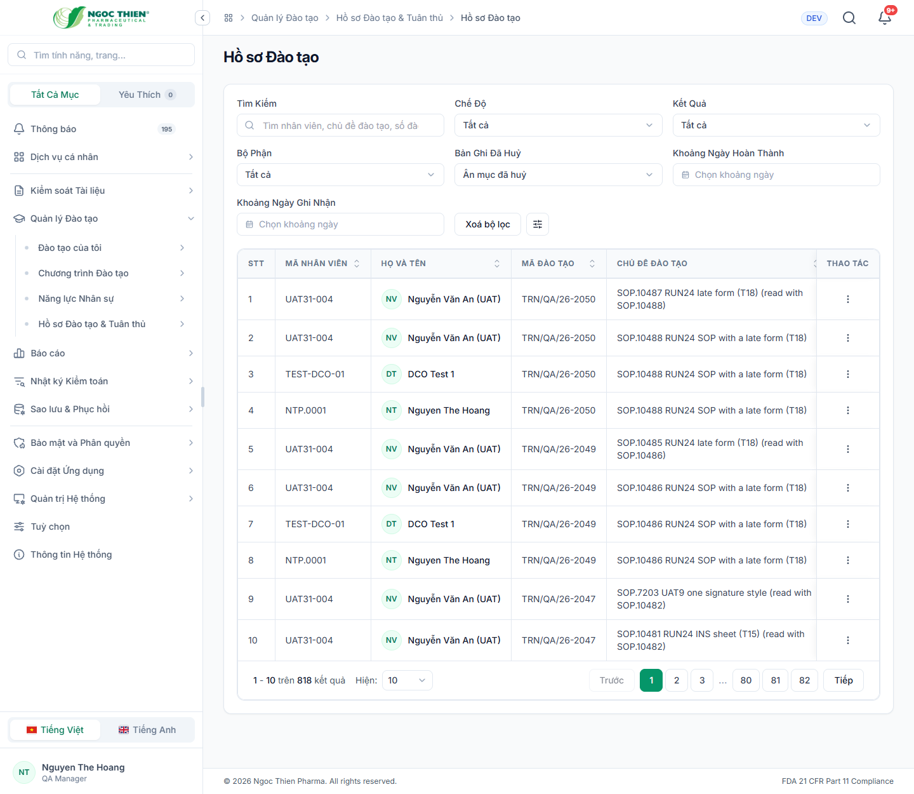

| Thao tác | Ai | Khi nào |
|---|---|---|
| Xem, lọc, tìm | Người có `training.record.view` (theo bộ phận) | Luôn |
| **Vô hiệu hoá một hồ sơ sai** (không phải xoá) | Người có `training.record.void` | Hồ sơ còn hiệu lực. **Bắt buộc ghi lý do và ký.** Hồ sơ bị vô hiệu hiển thị "Vô hiệu" cùng lý do |
| Hiện hồ sơ đã vô hiệu | Bộ lọc "Hồ sơ vô hiệu" | Mặc định ẩn |

---

## 7. Tuân thủ đào tạo (Training Compliance), SOP 5.1, 5.3.10

**Dùng để làm gì:** cho thấy **ai còn thiếu đào tạo** so với ma trận, và đưa họ vào đào tạo. Chọn **Bộ phận** ở đầu trang. Nút **In để thanh tra** (cần xem tuân thủ) in báo cáo.

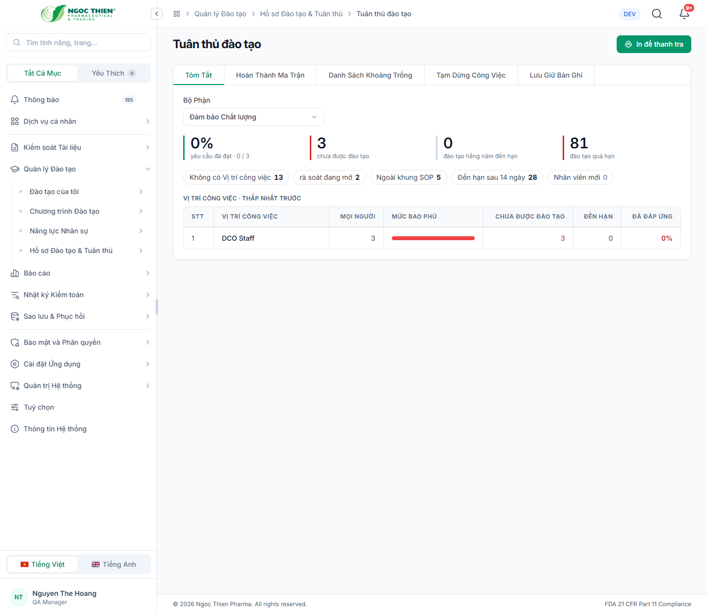

| Tab | Cho thấy gì | Ghi chú |
|---|---|---|
| **Tóm tắt** | Tỷ lệ yêu cầu đã đạt, số chưa được đào tạo, đào tạo hằng năm đến hạn, quá hạn; theo từng vị trí | Cần bộ phận có **ma trận hiệu lực**. Chưa có thì "chưa có gì để đo" |
| **Hoàn thành ma trận** | Theo dòng ma trận hoặc theo người: ai đã đủ | Dùng bộ lọc "Chỉ người có khoảng trống" |
| **Danh sách khoảng trống** | Từng người thiếu đào tạo nào | Chọn nhiều dòng rồi **Thêm vào một đào tạo** hoặc **Tạo đào tạo cho họ** |
| **Tạm dừng công việc** | Người bị tạm ngừng việc vì trượt bài kiểm tra, chờ đào tạo lại | Chỉ là **cờ nhắc**, không chặn các màn khác |
| **Lưu giữ bản ghi** | Hồ sơ người đã nghỉ việc, giữ tối thiểu 10 năm | Hệ thống **chỉ đánh dấu hết hạn lưu giữ**, không tự xoá |

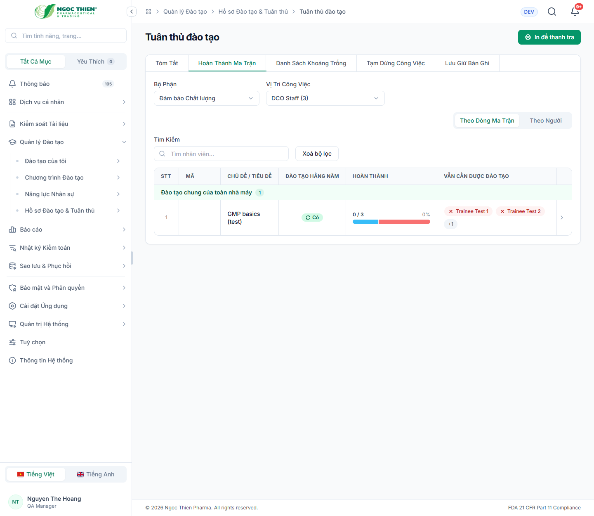
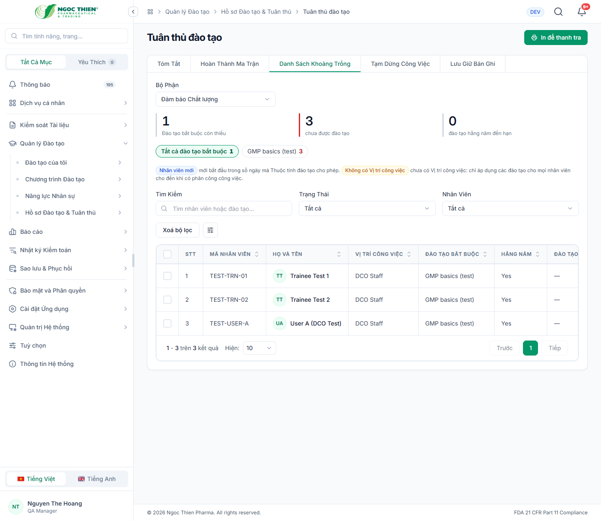
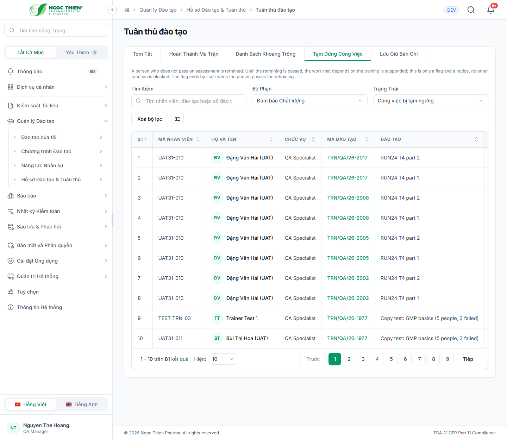
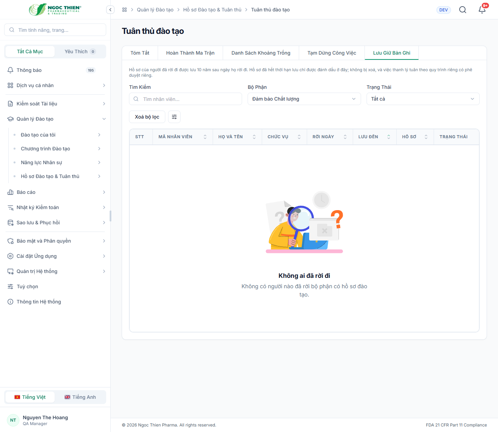

**Nút ở tab Danh sách khoảng trống:** "Thêm vào một đào tạo" và "Tạo đào tạo cho họ" chỉ dùng được khi bạn chọn ít nhất một dòng chưa xong (quyền cần có chưa được kiểm trong mã, QA nên thử bằng tài khoản không có quyền tổ chức đào tạo). Dòng "Chưa có đào tạo nào đã lên kế hoạch bao phủ" cho biết dòng đó cần tạo đào tạo mới.

---

## 8. Sổ cấp mã đào tạo (Training Number Allocation Log), SOP 5.1.4 (FRM.0044)

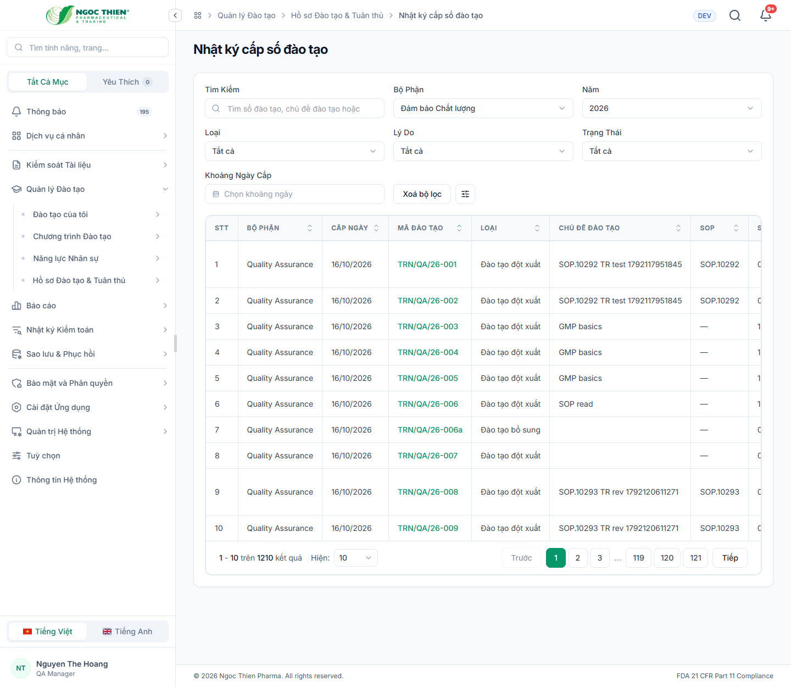

**Dùng để làm gì:** sổ cấp mã `TRN/DC/YY-XXX` của từng bộ phận. Mỗi buổi đào tạo bổ sung (hậu tố a, b, c) là **một dòng riêng**. **Chỉ xem**: hệ thống tự ghi khi tạo đào tạo, không có nút sửa. Lọc theo bộ phận và năm.

---

## 9. Xuất hồ sơ đào tạo (Training Record Exports), SOP 5.3.10

**Dùng để làm gì:** in hoặc xuất hồ sơ định kỳ hằng năm hoặc khi có yêu cầu. **Hệ thống chỉ tạo tệp, không tự gửi cho đơn vị quản lý.**

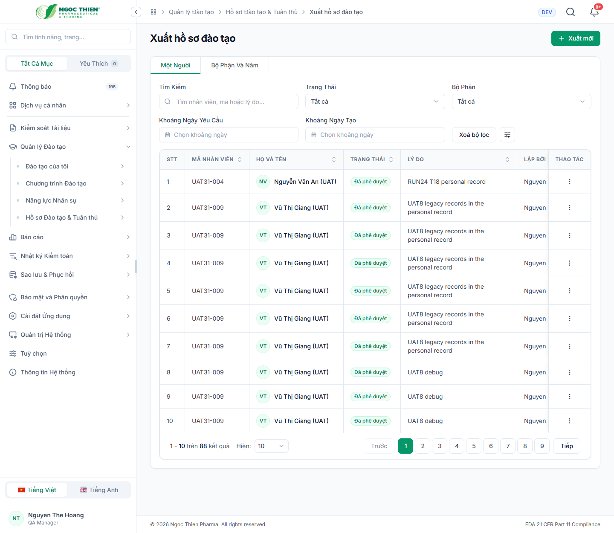
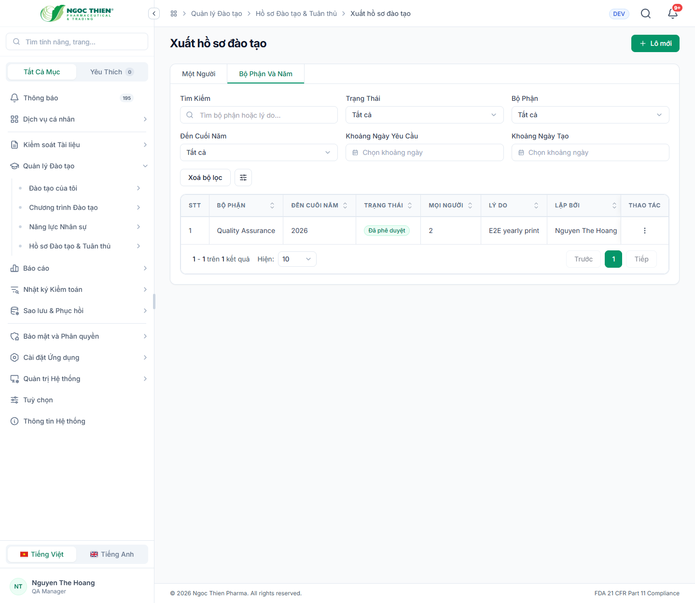

Cần quyền `training.record.export`; xuất theo bộ phận cần thêm quyền trong phạm vi bộ phận đó.

| Bước | Ai | Điều kiện |
|---|---|---|
| **1. Chuẩn bị** (một người, hoặc cả bộ phận trong một năm) | Người có `training.record.export` | Nhập lý do và **chọn người duyệt**. Bạn **ký** với tư cách người chuẩn bị |
| **2. Hoàn tất phê duyệt** hoặc **Từ chối** (lý do bắt buộc) | **Chỉ người được chọn duyệt** | Bản đang **Chờ duyệt** (nút `canApprove`). Người duyệt ký; hệ thống tạo tệp |
| **3. Tải PDF** (một người) hoặc **Tải ZIP** (cả lô, có mã băm) | Người có quyền xuất | Bản đã **Được duyệt** |

Hai bước ký tách hai người để người chuẩn bị không tự duyệt cho mình.

---

## 10. Bằng chứng đào tạo cũ (Legacy Training Evidence)

**Không có điều khoản riêng trong SOP.0003.** Đây là cơ chế của hệ thống: tài liệu **nhập từ bản giấy** mà theo quy định cần đào tạo, nhưng đào tạo đã làm trên giấy trước khi có phần mềm.

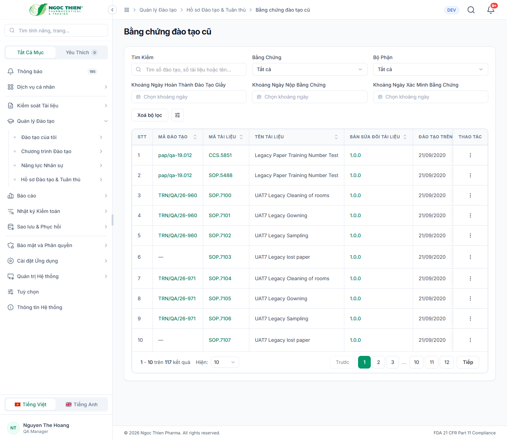

| Nút (menu dòng) | Làm gì | Ai | Hiện khi nào |
|---|---|---|---|
| **Đính kèm bản scan** | Tải PDF (tối đa 20 MB) scan hồ sơ đào tạo giấy, chọn **những người đã được đào tạo**, ký. Những người đó nhận hồ sơ đào tạo | Người có `training.activity.organize` | Dòng **chưa có bằng chứng** |
| **Khai báo: không có bằng chứng** | Ghi lý do không có bằng chứng, ký | Người có `training.activity.organize` | Dòng **chưa có bằng chứng** |
| **Xem bản scan**, **Tải bản scan** | Mở hoặc tải scan đã nộp | Người xem được màn | Dòng **đã có bằng chứng** và không phải loại "không có bằng chứng" |

---

## 11. Điều QA cần biết trước khi ký xác nhận

**Đã làm:** đọc điều kiện hiện nút trong mã nguồn (giao diện và máy chủ) cho từng màn; chụp ảnh trên DEV bằng tài khoản `admin`.

**Chưa làm:**
- Chưa bấm từng nút bằng các tài khoản khác nhau (QL, nhân viên, người duyệt) để xác nhận nút hiện đúng. Bảng "ai bấm, khi nào, hiện khi nào" là **suy ra từ mã**, chưa phải kết quả test.
- Chưa chụp ảnh các trạng thái khác của Phân công (Chờ chấp nhận, Hiệu lực) và hộp thoại ký, ngoại lệ, huỷ.
- Chưa kiểm hiệu ứng của bộ máy chính sách (Hybrid engine) lên từng nút.

**Điểm cần QA quyết định:**
1. **Chữ ký mẫu (5.3.9):** SOP yêu cầu duyệt trước khi áp dụng chữ ký mới; hệ thống áp dụng ngay khi tải lên (xem mục 5). Bước duyệt là việc ngoài hệ thống hay làm trong hệ thống?
2. **Chuyển địa điểm (5.3.11):** hệ thống chưa mô hình nhiều cơ sở, mới đáp ứng **một phần**.
3. **Gửi file mềm hồ sơ cho đơn vị quản lý (5.3.10):** hệ thống tạo tệp, **không tự gửi**; việc gửi do người làm.

## 11b. Kiểm phân quyền nút của Phân công công việc (2026-11-27, DEV)

**Cách kiểm:** đọc chính sách trong cơ sở dữ liệu DEV; đăng nhập 4 tài khoản, đọc nút máy chủ trả về cho 2 phân công **Bản nháp**, rồi gọi thẳng API bằng dữ liệu cố ý sai (không thể làm thay đổi bản ghi).

| Tài khoản | Nút máy chủ cho thấy | Gọi thẳng API |
|---|---|---|
| `admin`, `approver.test1`, `user.a.test` (có đủ quyền đào tạo, mọi bộ phận) | Lưu, Yêu cầu ngoại lệ, Ký và gửi, Huỷ | Được qua cổng quyền (bị chặn vì dữ liệu sai). Duyệt ngoại lệ: **403** vì không được chỉ định |
| `dco.test1` (chỉ quyền xem, là **người được giao** của một bản nháp) | Không nút nào | Mọi hành động **403**. Xem được phân công của mình; phân công bộ phận khác **403** |

**Chưa kiểm khi chạy:** trạng thái Chờ chấp nhận, Hiệu lực; người được chỉ định duyệt ngoại lệ; người có quyền chỉ trong một bộ phận; các màn khác ngoài Phân công.

**Điểm tìm thấy (đọc từ mã, chưa tái hiện trên DEV vì chưa có dữ liệu):**
1. **Nút "Yêu cầu ngoại lệ" vẫn hiện sau khi ngoại lệ đã được duyệt.** Máy chủ tính điều kiện "chưa được duyệt" nhưng kết quả của bộ máy chính sách **ghi đè** lên nó (`TrainingJobAssignmentService.withEngine`), và chính sách không biết điều kiện này. Máy chủ cũng không chặn: yêu cầu lại sẽ **xoá phê duyệt đã ký** (cột người duyệt và chữ ký của phân công bị đặt lại; chữ ký điện tử và Audit Trail vẫn còn).
2. **Người được giao mà có quyền quản lý vẫn sửa, huỷ, yêu cầu ngoại lệ cho phân công của chính mình.** Chính sách chỉ cấm họ ở "Ký và gửi" và "Duyệt ngoại lệ". Cần QA quyết định.
3. **"In để ký"** hiển thị theo chính sách của nút Huỷ, còn máy chủ kiểm quyền quản lý trực tiếp, không qua chính sách. Hiện trùng nhau; đổi chính sách Huỷ thì hai bên có thể lệch.

## 12. Gợi ý thứ tự test cho QA

1. **Phân công công việc:** tạo bản nháp cho nhân viên thiếu đào tạo → thử **Ký và gửi** (phải bị chặn) → **Yêu cầu ngoại lệ** → người duyệt **Hoàn tất phê duyệt** → **Ký và gửi** → đăng nhập nhân viên **Chấp nhận**. Kiểm: người giao **không** tự ký cho chính mình; người không phải người duyệt **không thấy** nút duyệt.
2. **Rà soát đào tạo:** mở review nhân viên mới → **Tạo đào tạo** cho một dòng → hoàn tất đào tạo → **Đóng review** (người đóng khác nhân viên).
3. **Tuân thủ:** xem Danh sách khoảng trống, thêm một người vào đào tạo, sau khi đào tạo xong kiểm người đó **biến khỏi** danh sách.
4. **Xuất hồ sơ:** chuẩn bị → người duyệt khác ký → tải; kiểm người chuẩn bị **không** tự duyệt được.
